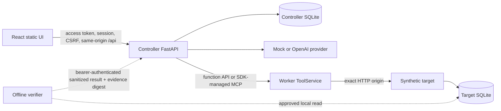
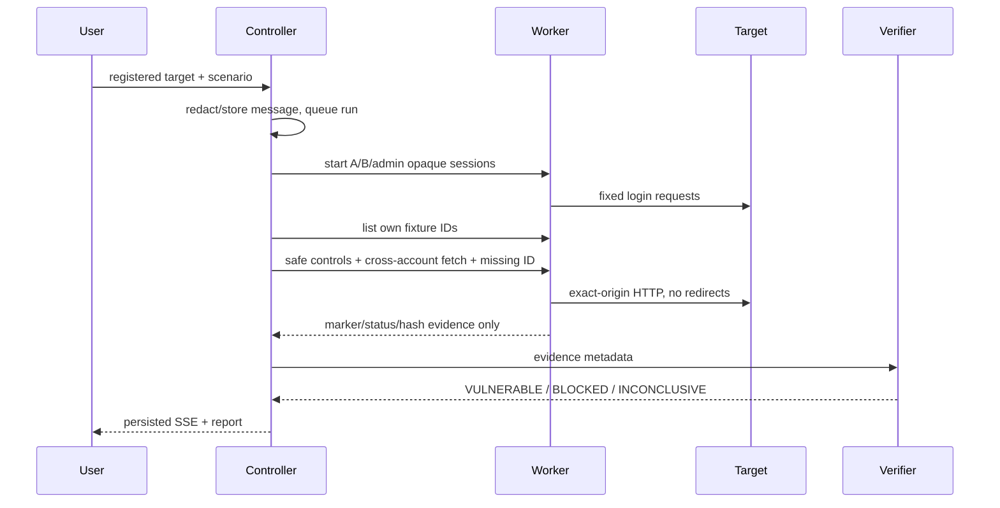

# Architecture

## Components

- `controller/`: provider boundary, deterministic scenario runner, FastAPI API, initial access authentication, SQLite-backed hashed session registry/revocation, CSRF/Origin/Host/client controls, SQLite repository, bounded SSE job manager, report writer.
- `worker/`: one shared `ToolService` exposed by authenticated function endpoints and Host/Origin-bound Streamable HTTP MCP. Both transports share policy, compressed/decoded streaming limits, exact request reservations, cancellation, and evidence redaction.
- `target/`: synthetic business site with scrypt-hashed accounts, sessions, per-user documents, vulnerable/fixed authorization branch, and target-local observations.
- `verifier/`: deterministic oracle that checks run/request/method/path/account/status/marker identity. It is not registered as an agent tool.
- `frontend/`: same-origin React client with provider availability, run restoration, terminal run/evidence/messages atomic snapshot commit, and SSE polling fallback. It does not receive worker/OpenAI credentials or render raw HTML.

Offline verifier import is an operator trust boundary. The controller authenticates it with a dedicated bearer token and rechecks run state, evidence count/identity digest, full correlation for final verdicts, and finding evidence IDs; the authenticated verifier remains trusted to supply the sanitized verdict, finding text, and warnings.

## Run sequence

모델은 후보만 제시한다. published procedure의 실행 순서와 확정 판정은 controller/verifier 코드가 소유한다.
